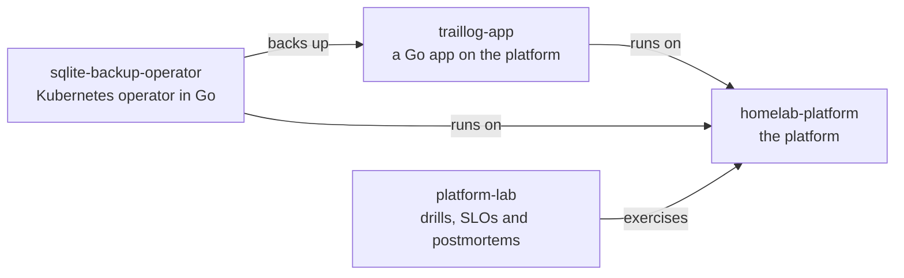

# Hi, I'm Maciej 👋

Senior Platform Engineer based in Poland. I build and run cloud platforms with **AWS, Kubernetes, Terraform, Crossplane and GitOps**, and write the automation around them in **Go and Python**. My path went from SysOps through DevOps to platform engineering, including leading an international team of more than 20 DevOps engineers.

I like boring infrastructure, reproducible configuration, least privilege, and recovery that has actually been tested.

## What's here

My personal work is built around a HomeLab platform: a Talos Linux Kubernetes cluster behind a NixOS gateway, managed with Argo CD. These repositories are curated public copies of private ones.

| Repository | What it shows |
| --- | --- |
| [homelab-platform](https://github.com/maciejlistos/homelab-platform) | Talos, NixOS, Argo CD, Cilium, Longhorn, Kyverno guardrails, Prometheus, Grafana and Loki; architecture docs and decision records |
| [traillog-app](https://github.com/maciejlistos/traillog-app) | A Go web app with OpenTelemetry, tests at every layer, a hardened container image and tested SQLite backups |
| [sqlite-backup-operator](https://github.com/maciejlistos/sqlite-backup-operator) | A Kubernetes operator in Go with controller-runtime, in development |
| [platform-lab](https://github.com/maciejlistos/platform-lab) | Kubernetes troubleshooting drills, Gateway API, supply-chain security, SLOs, postmortems and recovery drills |

## Find me

- [LinkedIn](https://www.linkedin.com/in/maciej-listos)
